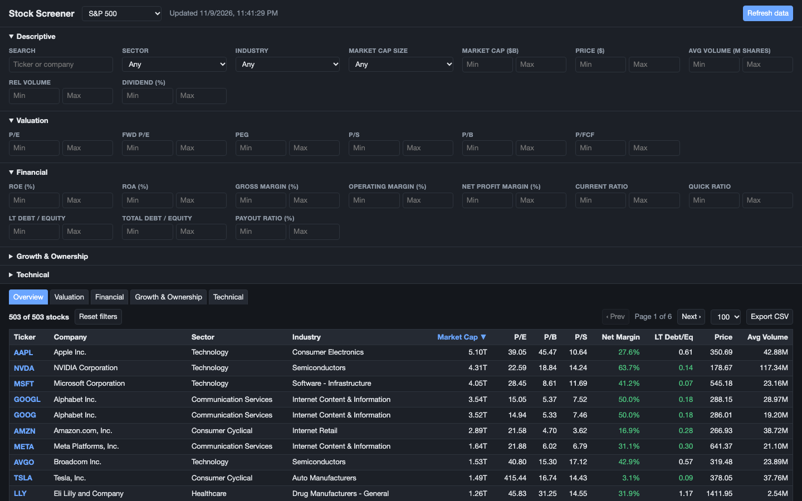

# Stock Screener

 

A FinViz-style stock screener that runs locally. It lets you filter and sort about 1,500 US stocks on more than 30 fundamental and technical metrics. It needs no account and no API key.



## Features

- **Four indexes:** S&P 500, S&P MidCap 400, S&P SmallCap 600 and Nasdaq-100, or all of them together
- **30+ metrics** covering valuation, profitability, balance sheet, growth, ownership and price action
- **Min/max filters** on every metric, plus sector, industry, market-cap size and ticker search
- **Five views** (Overview, Valuation, Financial, Growth & Ownership, Technical); filters and sorting carry across them
- **CSV export** of the filtered, sorted results
- **Local cache**, so after the first download the data loads instantly

## Tech stack

| Layer | What it uses |
|---|---|
| Data | [yfinance](https://github.com/ranaroussi/yfinance) (Yahoo Finance) and index membership from Wikipedia |
| Backend | Python standard-library HTTP server with a small JSON API |
| Frontend | A single HTML page in vanilla JavaScript, with no framework or build step |
| Storage | JSON files cached in `data/` |

## Quick start

Requires Python 3.

**macOS:** double-click **`Start Screener.command`**. It installs everything on first run and opens http://localhost:8765.

**Manual (any OS):**

```bash
python3 -m venv .venv
.venv/bin/pip install -r requirements.txt
.venv/bin/python server.py
# then open http://localhost:8765
```

The first run downloads the S&P 500, which takes a few minutes. After that, click **Refresh data** to update.

## How it works

```
Wikipedia index lists ─┐
                       ├─> fetcher.py ──> data/*.json cache ──> server.py (JSON API) ──> static/index.html
Yahoo Finance (yfinance)┘
```

| File | Role |
|---|---|
| `fetcher.py` | Gets index membership, downloads and cleans Yahoo data, calculates the derived metrics, writes the cache |
| `server.py` | Local web server bound to 127.0.0.1, which serves the page and `/api/indexes` and `/api/stocks` |
| `static/index.html` | The screener UI: filtering, sorting, views, pagination and CSV export |

## Using it

- **Sort:** click a column header, and click again to reverse. N/A values always sort last.
- **Filter:** values are entered in the units the column labels show. Market cap is in $ billions, average volume is in millions of shares, and percentage metrics are in percent.
- **Universe:** the dropdown switches index. Each index downloads the first time you pick it, and "All loaded" combines every index you've downloaded.
- **Retry failed:** this button appears if Yahoo skipped some tickers, which is usually rate limiting.

## Metric details

| Group | Metrics |
|---|---|
| Descriptive | Market cap, price, average volume (3 months), relative volume, dividend yield |
| Valuation | P/E, forward P/E, PEG, P/S, P/B, P/FCF |
| Financial | ROE, ROA, gross / operating / net margin, current ratio, quick ratio, LT debt/equity, total debt/equity, payout ratio |
| Growth & Ownership | EPS growth over 3 years, EPS and sales growth (latest quarter, year over year), insider and institutional ownership, short float, analyst rating, upside to price target |
| Technical | Beta, 52-week performance, distance from the 52-week high and low, price vs the 50-day and 200-day average |

How some of them are calculated:

- **LT debt/equity:** long-term debt / shareholder equity, from the latest quarterly balance sheet. N/A when equity is negative.
- **P/B:** Yahoo's figure, replaced by market cap / book equity when the two disagree badly (Yahoo is wrong for some multi-class shares such as BRK-B). N/A when book value is negative.
- **P/FCF:** market cap / trailing-twelve-month free cash flow. N/A when free cash flow is negative.
- **EPS growth 3 years:** annualized growth in diluted EPS across the four fiscal years Yahoo publishes. N/A if either end is a loss.
- **Analyst rating:** 1 = strong buy, 5 = sell.

## Disclaimer

Data comes from Yahoo Finance's unofficial feed and can be delayed, missing or wrong for individual stocks. Check the company's filings before you rely on a number. This is not investment advice.

## License

[MIT](LICENSE)
